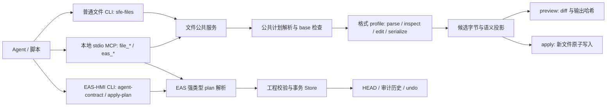

# EAFS：让 Agent 直接阅读和编辑文件结构

本文面向使用者、文件格式实现者和希望共同开发的贡献者。EAFS v0.2 发布候选原有 30 个可编辑 profile：EAS-HMI 工程模型和 29 种普通文件格式；当前开发分支另加入一个 Minecraft Java 26.3 世界目录实验 demo 和离线语义建筑场景。产品版本与计划协议分开，现有计划仍使用兼容的 `sfe/0.1`。**EAFS 是本项目暂用的方案名称，`sfe/0.1` 是仓库内可运行的实验协议；两者均不是已获外部机构采纳的标准。**每个 profile 只承诺下文列出的操作子集。原候选发布范围与验证状态见 [v0.2 候选报告](EAFS-V0.2-RELEASE.md)；Minecraft 范围见[专门说明](EAFS-MINECRAFT-JAVA-26-3.md)。

## 主要理念

Agent 从文件本身取得结构、对象地址和当前状态，提交由数据组成的编辑计划。执行器理解目标格式，验证整个计划，先展示差异，再提交结果。流程不依赖屏幕截图、窗口坐标或模拟鼠标操作。

```text
发现指令集 → status 读取状态 → inspect 定位对象 → 编写绑定旧状态的 plan
                                             ↓
核对结果 ← apply 提交新版本 ← preview 验证整组指令与差异
```

这个方法依赖四个约束：

1. **目标可寻址**：优先使用文件内稳定 ID；没有 ID 时使用唯一业务键或带当前状态保护的序号。含糊的目标必须拒绝。
2. **指令有边界**：计划只包含 JSON 数据和 profile 声明的操作，不执行计划中的代码。解析器需说明支持的格式子集与无法验证的语义。
3. **状态可核对**：普通文件以原始字节 SHA-256 为前置条件；Minecraft 世界目录以全目录文件清单与字节的 SHA-256 为前置条件；EAS-HMI 以 revision 和语义哈希为前置条件。旧计划返回冲突。
4. **整组生效**：所有步骤按顺序在候选状态上执行；任一步失败，不发布部分结果。`preview` 不提交，`apply` 才发布。

该方法适合配置、数据、文档和工程对象的可审计修改。文件结构校验不能代替 Office 排版、CAD 视觉效果、KiCad ERC 等领域检查；这些检查应作为对应 profile 的验证范围明确记录。

## 一次可运行的操作

在仓库根目录安装开发依赖，然后运行现成 JSON 样例：

```sh
python -m pip install -e '.[dev]'
python -m sfe_files.cli contract
python -m sfe_files.cli status examples/sfe/settings.json
python -m sfe_files.cli inspect examples/sfe/settings.json --pointer /enabled
python -m sfe_files.cli preview examples/sfe/settings.json examples/sfe/settings.plan.json
python -m sfe_files.cli apply examples/sfe/settings.json examples/sfe/settings.plan.json --output build/settings-edited.json
python -m sfe_files.cli inspect build/settings-edited.json --pointer /enabled
```

`contract` 返回格式、扩展名或目录类型、操作名，以及各 profile 的参数示例和限制。原有样例及逐条命令见[样例索引](../examples/sfe/README.md)；`python scripts/demo_sfe.py` 仍运行 v0.2 候选的 30 个 profile。Minecraft 世界目录单独按[demo 指南](EAFS-MINECRAFT-JAVA-26-3.md)运行。

## 主要架构



| 层 | 仓库位置 | 职责 |
|---|---|---|
| 普通文件 CLI | [`src/sfe_files/cli.py`](../src/sfe_files/cli.py) | JSON 输入输出、能力发现、状态读取、差异预览、新文件写出、错误退出码 |
| 文件公共服务 | [`src/sfe_files/service.py`](../src/sfe_files/service.py) | 供 CLI 和 MCP 共用的 `contract/status/inspect/preview/apply` 实现 |
| 公共执行器 | [`src/sfe_files/core.py`](../src/sfe_files/core.py) | 扩展名映射、懒加载 profile、严格 plan 封套、源字节哈希检查、顺序执行、候选字节与结果哈希 |
| MCP 适配层 | [`src/sfe_files/mcp_server.py`](../src/sfe_files/mcp_server.py) | 13 个 stdio 工具、JSON plan 入参、结构化结果、工作区根路径限制 |
| 文件 profile | [`src/sfe_files/`](../src/sfe_files/) 下的 `*_profile.py` | 格式解析、对象定位、指令校验、编辑、序列化；结构化格式可提供语义投影 |
| Minecraft 世界目录 demo | [`minecraft_world.py`](../src/sfe_files/minecraft_world.py)、[`minecraft_region.py`](../src/sfe_files/minecraft_region.py) | 26.3 目录指纹、方块定位、有限区块改写、新目录发布 |
| 包文件辅助层 | [`src/sfe_files/ooxml.py`](../src/sfe_files/ooxml.py) 等 | 处理 ZIP/XML 部件；未改部件保留，已改部件重新序列化 |
| EAS-HMI 接口 | [`src/eas_hmi/agent_protocol.py`](../src/eas_hmi/agent_protocol.py)、[`cli.py`](../src/eas_hmi/cli.py) | 独立的强类型 plan、工程节点指令和能力表 |
| EAS 事务层 | [`src/eas_hmi/operations/transaction.py`](../src/eas_hmi/operations/transaction.py) | 项目锁、完整校验、单次提交、审计和撤销 |

CLI 和本地 stdio MCP 均已可运行。安装 `python -m pip install -e '.[mcp]'` 后，可用 `eafs-mcp` 或 `python -m sfe_files.mcp_server` 启动服务；由 MCP host 通过 stdin/stdout 调用。文件工具为 `file_contract`、`file_status`、`file_inspect`、`file_preview`、`file_apply`；EAS 工具为 `eas_contract`、`eas_status`、`eas_query`、`eas_inspect`、`eas_context`、`eas_preview`、`eas_apply`、`eas_undo`。MCP 的配置、完整参数、路径边界与验证见[适配层说明](EAFS-MCP.md)。现有 EAS Visual MCP 是独立组件；本适配层以 `sfe/0.1` 的文件与 EAS-HMI 指令集为目标。

## 已支持格式与指令集

表中的“查看地址”是典型例子；指令名和参数以运行时 `contract` 或 EAS `agent-contract` 为准。表内序号通常只在 plan 绑定的原始状态下有效。

| 类别 | 格式 / 扩展名 | 典型查看地址 | 修改指令 |
|---|---|---|---|
| 工程模型 | EAS-HMI 工程 | 节点 ID、`query`、`context` | `move`、`set`、`resize`、`bind`、`unbind`、`align`、`distribute` |
| 实验世界目录 | Minecraft Java 26.3 世界文件夹 | `/blocks/minecraft:overworld/0/-40/0` | `replace-block`、`fill-box`、`clear-box`、`replace-box`、`paint-runs` |
| 基础数据 | JSON `.json` | `/enabled` | `add`、`set`、`remove`、`append` |
| 基础数据 | CSV `.csv` | `--key-column id --key P-01` | `set-cell`、`append-row`、`delete-row` |
| 文本 | Markdown `.md/.markdown` | `--heading Findings` | `replace-section`、`append-section` |
| 配置 | YAML `.yaml/.yml` | `/spec/replicas` | `add`、`set`、`remove`、`append` |
| 配置 | TOML `.toml` | `/server/port` | `add`、`set`、`remove`、`append` |
| 矢量图 | SVG `.svg` | `--id pump-label` | `set-attribute`、`remove-attribute`、`set-text`、`translate` |
| 常用办公 | Excel `.xlsx` | `/sheets/Budget/B5` | `set-cell`、`set-formula` |
| 常用办公 | Word `.docx` | `/paragraphs/2`、`/tables/1` | `set-paragraph`、`set-table-cell`、`append-paragraph` |
| 常用办公 | PowerPoint `.pptx` | `/slides/1/shapes/2` | `set-text`、`move`、`resize` |
| 字幕 | SRT `.srt` | `/cues/2` | `set-text`、`shift-time`、`set-timing` |
| 字幕 | WebVTT `.vtt` | `/cues/2` | `set-text`、`shift-time`、`set-timing` |
| 日程 | iCalendar `.ics` | `/events/<UID>` | `set-event-field`、`reschedule` |
| 联系人 | vCard `.vcf` | `/contacts/<UID>` | `set-property`、`add-property` |
| 逐行数据 | JSONL `.jsonl/.ndjson` | `/by-key/id/P-01` | `set-field`、`replace-record`、`append-record`、`delete-record` |
| 开放办公 | Writer `.odt` | `/paragraphs/2`、`/tables/Actions` | `set-paragraph`、`set-table-cell`、`append-paragraph` |
| 开放办公 | Calc `.ods` | `/sheets/Costs/B3` | `set-cell`、`set-formula` |
| 开放办公 | Impress `.odp` | `/slides/1/objects/status` | `set-text`、`move`、`resize` |
| 网页 | HTML `.html/.htm` | `/elements/status` | `set-text`、`set-attribute`、`remove-attribute`、`append-element` |
| 阅读 | EPUB `.epub` | `/chapters/review/elements/status` | `set-metadata`、`set-text`、`set-modified` |
| 图示 | draw.io `.drawio` | `/pages/2/cells/pump` | `set-label`、`move`、`resize`、`connect` |
| 位置 | GeoJSON `.geojson` | `/by-id/pump`、`/features/1` | `set-property`、`set-point` |
| 位置 | GPX `.gpx` | `/routes/1/points/2` | `set-name`、`set-point`、`set-time` |
| 位置 | KML `.kml` | `/placemarks/pump` | `set-name`、`set-description`、`set-point` |
| 数据库 | SQLite `.sqlite/.sqlite3/.db` | `/tables/equipment/rows/P-01` | `set-cell`、`append-row`、`delete-row` |
| 列式数据 | Parquet `.parquet` | `/by-key/id/P-01` | `set-field`、`append-row` |
| 列式数据 | Arrow IPC file `.arrow/.feather` | `/by-key/id/P-01` | `set-field`、`append-row` |
| CAD | DXF `.dxf` | `/entities/32` | `set-text`、`translate`、`set-layer` |
| 电路 | KiCad 原理图 `.kicad_sch` | `/symbols/<UUID>` | `set-property`、`move-symbol` |
| 乐谱 | MusicXML `.musicxml` | `/parts/P1/measures/1/voices/1/notes/3` | `set-pitch`、`set-duration`、`set-dynamics` |

`.xls/.doc/.ppt` 旧二进制 Office 文件不在上述 profile 中，需实际转换，改扩展名不能转换内容。各格式的完整受限范围见[接口草案](STRUCTURED-FILE-EDITING.md)、[日常文件](EAFS-DAILY-FILES.md)、[办公与阅读](EAFS-OFFICE-READING.md)及[批次 3—5](EAFS-BATCHES-3-5.md)。

## `sfe/0.1` 技术规范：当前实现

### 1. Plan 封套与状态前置条件

普通文件计划是严格的 JSON 对象，仅接受 `protocol`、`format`、`base`、`steps` 四个顶层字段；`steps` 是非空数组。普通文件的 `format` 必须与输入扩展名映射的 profile 一致，`base.sha256` 必须等于读取到的**原文件字节**的 SHA-256。Minecraft 目录 profile 以目录类型识别，`base.sha256` 绑定全目录指纹，详见其专门说明。

```json
{
  "protocol": "sfe/0.1",
  "format": "json",
  "base": {"sha256": "5bc2c01c09988bd96f742ab7f8228cc29b93d5ed67829cf6153f40c431de6e93"},
  "steps": [
    {"op": "set", "pointer": "/enabled", "value": true},
    {"op": "append", "pointer": "/alarms", "value": "low-pressure"}
  ]
}
```

EAS-HMI 使用同一封套，但 `format` 是 `eas-hmi`，`base` 是 `revision` 与 `semantic_hash`。生成计划时，将 `eas-hmi status` 返回的 `canonical_hash` 填入 `semantic_hash`。这两类哈希含义不同，不能互换。

```json
{
  "protocol": "sfe/0.1",
  "format": "eas-hmi",
  "base": {"revision": 0, "semantic_hash": "db119b2b29ec29fe75a0afa6f099f6e53835454f9b9ee41400707e9ed702bea3"},
  "steps": [{"op": "move", "ids": ["CARD_A"], "dx": 10, "dy": 5}]
}
```

仓库中的 EAS 固定计划可在全新工程上运行：

```sh
python -m eas_hmi.cli --project build/sfe-eas init --from-model examples/stage4/model.json
python -m eas_hmi.cli --project build/sfe-eas agent-contract
python -m eas_hmi.cli --project build/sfe-eas status
python -m eas_hmi.cli --project build/sfe-eas apply-plan examples/sfe/eas.plan.json --dry-run
python -m eas_hmi.cli --project build/sfe-eas apply-plan examples/sfe/eas.plan.json
```

计划的 base 绑定样例模型的初始状态；再次运行 `init` 或 `apply-plan` 时，应换用新工程路径或根据当前 `status` 重新生成计划。

### 2. 发现、读取、预览和提交

| 阶段 | CLI | MCP 工具 | 关键返回字段与行为 |
|---|---|---|---|
| 发现 | `sfe-files contract`；`eas-hmi agent-contract` | `file_contract`；`eas_contract` | 协议版本、格式和操作；各文件 profile 的参数示例及限制，EAS 的 plan JSON Schema |
| 状态 | `sfe-files status PATH`；`eas-hmi status` | `file_status`；`eas_status` | 文件或世界目录 `format/sha256/summary`；EAS `revision/canonical_hash` |
| 定位 | `sfe-files inspect FILE ...`；`eas-hmi inspect ID` | `file_inspect`；`eas_query`、`eas_inspect`、`eas_context` | 指定对象内容及当前状态；不同格式使用各自的寻址参数 |
| 预览 | `sfe-files preview FILE PLAN`；`eas-hmi apply-plan PLAN --dry-run` | `file_preview`；`eas_preview` | 运行全部步骤并校验，不提交；文件返回前后哈希、差异和 `committed:false`，EAS 返回变更与校验结果 |
| 提交 | `sfe-files apply PATH PLAN --output NEW_PATH`；`eas-hmi apply-plan PLAN` | `file_apply`；`eas_apply` | 文件或世界目录输出到不存在的新路径并保留输入；EAS 在项目锁下提交一个 revision |
| 撤销 | `eas-hmi undo` | `eas_undo` | 按预期 revision 撤销 EAS 事务 |

普通文件的 `preview` 差异可为文本 diff 或 `diff_kind:semantic`；ZIP 包 profile 还能返回变化部件；Minecraft 目录 demo 返回方块语义变化及受影响的 region 路径。差异可能按 `--limit` 截断，因此完整核对仍应检查目标对象及 `after_sha256`。`apply` 拒绝覆盖源文件或已有输出；普通文件的输出扩展名必须映射至同一格式，Minecraft 的输出必须是新目录。EAS-HMI 的 `apply-plan` 支持原有审计历史与 `undo`。

CLI 从计划文件读取 JSON；MCP 的 `file_preview`、`file_apply`、`eas_preview`、`eas_apply` 直接接收 `plan` JSON 对象。两种入口使用同一计划封套和状态前置条件。错误以 JSON 返回，基本形状为 `{"ok":false,"code":"BASE_CONFLICT","message":"..."}`。CLI 的普通文件计划/格式错误退出码为 2，I/O 错误为 4；EAS-HMI 使用自身的错误码和退出码。MCP 业务错误设置 `isError:true`，同时在 `structuredContent` 返回 `ok:false`、`code` 和 `message`。调用方应判断结构化字段；CLI 还应判断进程退出码，避免依赖错误说明文本。`BASE_CONFLICT` 表示先重新读取状态，再生成新计划；不能直接换掉 plan 中的哈希而跳过重新检查。

### 3. 寻址与指令语义

`sfe/0.1` 标准化的是工作流和封套，**不强制不同格式共用一种地址或 `set` 语义**。JSON/YAML/TOML 等使用 [JSON Pointer](https://www.rfc-editor.org/rfc/rfc6901) 时，空字符串表示根，`~1` 表示 `/`，`~0` 表示 `~`；数组一般从 0 编号。文档、图示和位置格式的表内地址可能从 1 编号；profile 必须在 `CONTRACT` 中写明。`add`、`set`、`remove`、`append` 是本项目指令，不代表实现了完整 [JSON Patch](https://www.rfc-editor.org/rfc/rfc6902)。

每条指令是一个带 `op` 的 JSON 对象。profile 应明确要求的字段、允许的值类型、单位、目标缺失或歧义时的行为，以及跨字段约束。不要默默猜测表格行、图形对象或地理坐标；对不支持的结构返回稳定错误码。若源格式保存派生值或引用，编辑器应更新它们、使其失效并说明重算方式，或拒绝这项操作。

### 4. 执行与兼容要求

- 以读取到的源字节建立候选状态，按 `steps` 顺序编辑，并在全部步骤完成后序列化和校验。失败不得发布部分结果。
- 普通文件以源字节哈希、Minecraft 世界目录以全目录指纹检查过期计划；`preview` 与相同输入的 `apply` 应给出相同 `after_sha256`。序列化器应避免随机时间戳等不稳定输出。
- 未触及内容能保留时应保留；若库会规范化空白、压缩字节或 XML 序列化，需在 `limitations` 里说明。对 ZIP 包，未修改成员的解压后 payload 应保持一致；不承诺整包压缩字节一致。
- 当前 `sfe/0.1` 的字段或操作发生不兼容变化时，需使用新协议版本或新的 profile/操作，并保留旧计划的可解释错误；不能改变已有操作的目标、单位或结果含义却沿用同一契约。
- CLI 与 stdio MCP 复用现有计划及返回语义。若贡献其他传输方式或 host 接入，应单独测试其工具发现、结构化结果及错误处理；本地 stdio 测试不代替跨 host 互操作测试。

## 共同开发：如何新增或扩展一个 profile

1. **确定明确子集**：先选有稳定地址和独立验证手段的对象。列出文件版本、扩展名、编码、支持的结构、拒绝的结构和不会校验的外部效果。
2. **写指令契约**：为每个操作给出 `op`、字段、类型、单位、地址示例、失败条件；命名尽量沿用已有动词，但只在语义确实相同时复用。能力表必须把限制写清楚。
3. **接入实现**：在 `src/sfe_files/core.py` 的 `FORMATS`/`ADAPTERS` 注册普通文件格式；实现 `OPS`、`CONTRACT`、`parse(data)`、`summary(document)`、`inspect(document, pointer)`、`edit(document, step)`、`serialize(document)`。结构复杂时提供 `projection(document)` 生成有界、稳定的语义差异。EAS 工程操作则改动 `agent_protocol.py` 的强类型 plan 与相应事务操作。
4. **准备可运行样例**：在 `examples/sfe/` 放真实且可公开的源文件与固定 `base` 计划；在样例索引中加入从 `status` 到 `apply` 的命令。样例应同时含目标对象和至少一个不应变化的对象。
5. **验证行为**：测试发现契约、读取、预览不落盘、相同 plan 的预览/应用哈希一致、源文件不变、旧 base 拒绝、步骤失败不写输出，以及独立解析器能读出编辑结果。涉及格式 Schema、渲染、公式、拓扑或电气规则时，加相应外部校验并记录尚未覆盖的范围。
6. **核对 MCP 入口**：新普通文件 profile 应由通用 `file_contract(format_name)` 发现，并用相同 plan 验证 `file_status`、`file_inspect`、`file_preview`、`file_apply`；若新增独立 MCP 工具，保持 `mcp_server.py` 只做参数映射和结果封装，业务逻辑放在公共服务或 profile。测试应通过真实 stdio 会话核对工具发现、结构化结果和错误。
7. **更新交付说明**：更新此表、[详细接口草案](STRUCTURED-FILE-EDITING.md)、[MCP 适配层说明](EAFS-MCP.md)、[路线图](EAFS-FORMAT-ROADMAP.md)和 `scripts/demo_sfe.py`；提交代码、测试和样例。不要把 `build/` 演示产物当作源文件提交。

新 profile 的 `CONTRACT` 至少包含 `addressing`、`operations`、`limitations`。`operations` 的键要与 `OPS` 完全一致，每个操作给出带相同 `op` 值的可执行参数示例。测试应覆盖 `contract` 能发现这些信息，而非只验证内部函数。现有 [profile CLI 测试](../tests/test_sfe_profiles_cli.py)与[第 3—5 批端到端测试](../tests/test_sfe_batches_3_5.py)可作为起点。

例如，新增格式的能力声明可采用以下形状；示例值必须与该 profile 实际接受的计划一致：

```python
OPS = {"set-label"}
CONTRACT = {
    "addressing": "Inspect /objects/<id>; plans use a unique object id.",
    "operations": {
        "set-label": {
            "example": {"op": "set-label", "id": "pump", "value": "Pump ready"},
            "description": "Replace one existing object's plain-text label.",
        }
    },
    "limitations": ["Only objects with unique ids and plain-text labels are editable."],
}
```

## 当前验证和仍需协作的方向

在 v0.2 修订前的本地工作树中，整库测试 **755 项通过**，其中包括真实 stdio MCP 会话；30 格式演示执行 **210 次 CLI 调用、199 项检查**，全部通过。该运行不是 v0.2 发布候选的干净安装证据，候选结果单独记录在 [发布报告](EAFS-V0.2-RELEASE.md)。GPX、KML、MusicXML 的样例与编辑结果通过相应 XML Schema，合计 6/6。KiCad ERC 和原生应用加载、CAD 视觉排版及跨 Agent host 互操作尚未完成验证。这些是适合贡献者参与的具体工作，另外也欢迎补充复杂对象、独立读取器测试及跨实现契约测试。

详细方法、边界与规范来源见[结构化文件编辑接口草案](STRUCTURED-FILE-EDITING.md)；格式开发的后续批次和验证要求见[路线图](EAFS-FORMAT-ROADMAP.md)。
